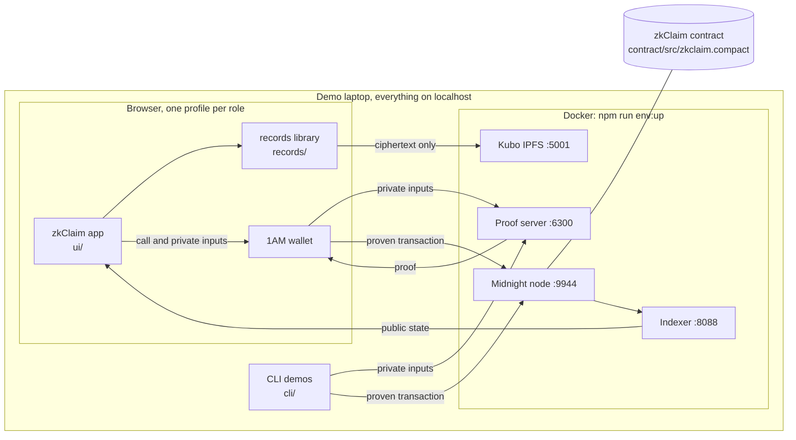
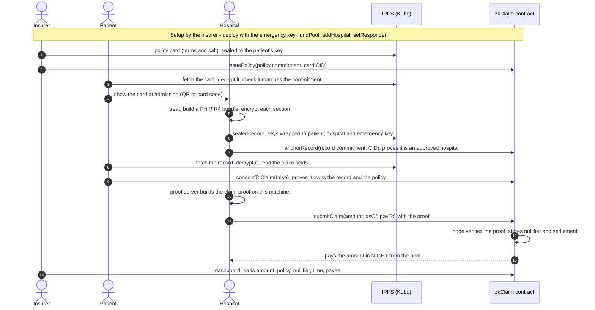
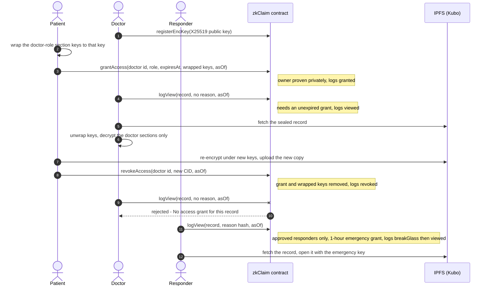

# zkClaim architecture

zkClaim lets a hospital prove that an insurance claim follows the policy rules and get paid by a Midnight contract, without the insurer seeing the diagnosis, the procedure or the prescriptions. Patients keep their health records encrypted on IPFS and decide, on-chain, who may read them.

This page covers the parts, the claim and access flows, what is on-chain, the claim proof, and how each W3-01 requirement is met. Risks and limits are in [threat-model.md](threat-model.md).

## Parts

| Part | What it does | Where |
|---|---|---|
| zkClaim app | Web app for every role: insurer, hospital, patient, doctor/lab/pharmacy, emergency responder, plus a tamper lab. Demo mode runs the contract in the page; live mode (in progress) uses 1AM and the devnet. | [`ui/`](../ui/) |
| Records library | Builds FHIR R4 bundles, encrypts each section with its own AES-256-GCM key, wraps keys with X25519, stores JSON on IPFS. | [`records/`](../records/) |
| 1AM wallet | Browser wallet. Holds NIGHT, pays fees in DUST, sends the private inputs to the proof server, submits the transaction. | setup in [`e2e/README.md`](../e2e/README.md) |
| Proof server | Turns private inputs into a zero-knowledge proof. It runs on the same machine, so private inputs do not leave it. | [`docker-compose.yml`](../docker-compose.yml), `proof-server:9.0.2` |
| Midnight node | Local devnet. Verifies each proof and applies the call. | `midnight-node:2.1.101` |
| Indexer | Serves public contract state to the app and the CLI. | `indexer-standalone:4.4.101` |
| Kubo | Local IPFS node for sealed records and sealed policy cards. It runs with `--offline`, so nothing is announced to the public IPFS network. RPC API on :5001 (CORS allows the app on :5173), gateway on :8081. | `ipfs/kubo:v0.43.1` |
| zkClaim contract | The claim proof, the payout pool, record anchors, access grants and the audit trail. | [`contract/src/zkclaim.compact`](../contract/src/zkclaim.compact) |
| CLI demos | Run the claim flow (`npm run demo`) and the records and access flow (`npm run demo:access`) headless, with real proofs. `npm run demo` is the stage fallback. | [`cli/src/demo.ts`](../cli/src/demo.ts), [`cli/src/demo-access.ts`](../cli/src/demo-access.ts) |

## Identities and keys

Each person has three kinds of key. Secret halves never leave their device.

| Key | What it is | Used for |
|---|---|---|
| zkClaim identity | 32 random bytes `sk`. The public id is `pk = persistentHash(["zkclaim:pk:v1", sk])`. | Every circuit that needs a role proves knowledge of the `sk` behind a `pk`: insurer, approved hospital, record owner, grantee, responder. |
| Encryption key | An X25519 key pair. A grantee publishes the public half with `registerEncKey`. | Wrapping record keys and policy cards to a person. |
| Wallet | 1AM in the browser, a seed wallet in the CLI. | Holding NIGHT and paying fees. It never decides who may do what. |

The contract does not use the wallet's key (`ownPublicKey()`) for authorization, because the prover supplies that value. The emergency key is a separate X25519 key pair. Its public half is a constructor argument, fixed when the insurer deploys the contract; no circuit changes it. In the design the key pair belongs to the emergency service (`npm run demo:access` generates it apart from the insurer's identity). In the app's demo mode every role shares one page, which generates it at deploy. The threat model covers what this trust means (L4).

## The claim flow

1. **Setup.** The insurer deploys the contract with its id and the emergency public key, funds the payout pool (`fundPool`), approves hospitals (`addHospital`) and approves responders (`setResponder`). Both are actions of the insurer's `admin` circuit.
2. **Policy.** The insurer writes the terms: holder id, limit, expiry, and up to 8 covered procedure codes. On-chain it publishes only `persistentCommit(terms, salt)` and the IPFS CID of the policy card. The card holds the terms and the salt, sealed to the patient's key.
3. **Treatment.** The patient shows the card to the hospital, which now holds the terms and salt too. The hospital treats the patient and builds a FHIR R4 bundle. The records library encrypts each section with its own key and wraps the keys to the patient, the hospital and the emergency key. The claim fields and their salt go in the sealed record too, where only the patient and the hospital can open them.
4. **Anchor.** The hospital commits to the claim fields: patient id, hospital id, procedure code, amount, and a hash of the FHIR bundle. It calls `anchorRecord(commitment, cid)`. The circuit proves the caller is on the approved list without saying which entry.
5. **Consent.** The patient's app decrypts the record and shows what will be claimed. `consentToClaim(false)` proves the patient owns both the policy and the record, then publishes a consent tag. The tag uses the record's private salt, so nobody can link it to the record or the policy. Until the claim is paid, the patient can withdraw that permission with `consentToClaim(true)`, under the same ownership checks, which removes the tag. Ledger order decides: a withdrawal that lands first stops even a claim the hospital has already proved, because the node rejects a call built on state that has since changed. Once the claim is paid, a withdrawal fails with `Claim already settled`; nothing is refunded. The permission has no expiry.
6. **Claim.** The hospital calls `submitClaim(amount, asOf, payTo)`. The proof server builds the proof on the hospital's machine. The statement is below.
7. **Settlement.** The node verifies the proof and applies the call. The contract stores `{policy, amount, at}` under the claim's nullifier, adds the amount to the policy's running total, and sends the amount in NIGHT from the pool to `payTo`. There is no approval step and no reject button.
8. **Dashboard.** The insurer reads settlements from the indexer: amount, policy commitment, nullifier, time and payee. Nothing else about the claim is on-chain.

Where a check fails: the circuit's `assert` fails on the caller's machine, no proof can be built, and the app shows the assert's message, such as `Claim already settled`. The node also rejects a transaction whose proof was built against state that has since changed, for example a nullifier spent in the meantime.

## The records and access flow

A record is a FHIR R4 bundle with Patient, Encounter, Condition, Procedure, Observation, MedicationRequest and Claim resources, coded with ICD-10, CPT, LOINC and RxNorm ([`records/src/fhir.ts`](../records/src/fhir.ts)). The library splits it into four sections and adds a fifth part, the claim data: the contract's treatment record and its salt. Each part is encrypted with its own random AES-256-GCM key, with the part's name bound in as associated data, so a box cannot be moved to another slot ([`records/src/record.ts`](../records/src/record.ts)).

| Part | Contents | Who can open it (`ROLE_SECTIONS`) |
|---|---|---|
| clinical | Patient, Encounter, Condition, Procedure | patient, hospital, doctor, emergency |
| labs | Observation | patient, hospital, doctor, emergency, lab |
| medications | MedicationRequest | patient, hospital, doctor, emergency, pharmacy |
| claim | FHIR Claim | patient, hospital |
| claim data | treatment record fields and salt, used in the proofs | patient, hospital |

Keys are wrapped with ECIES: an ephemeral X25519 key, HKDF-SHA256 and AES-256-GCM, all on WebCrypto ([`records/src/crypto.ts`](../records/src/crypto.ts)). The sealed record holds three wrapped key sets, for the patient, the hospital and the emergency key. It names slots, not the recipients' public keys. A grant wraps only the grantee's role keys (`grantKeyFor`). The record's `contentHash` is the SHA-256 of the bundle's canonical JSON. The policy card is about 250 bytes, shown as a card code or QR, and sealed to the patient before it goes to IPFS ([`records/src/card.ts`](../records/src/card.ts)).

- **Grant.** `grantAccess` (the `setAccess` circuit with role 1–3) proves the caller is the patient in the record (private), checks the role is doctor (1), lab (2) or pharmacy (3), and checks the expiry is in the future. The emergency role (4) only comes from an emergency `logView`. It stores `{expiresAt, role}` and the wrapped keys under `grantKey(record, grantee)`, then writes an audit entry. The patient's id is not written on-chain.
- **View.** The app calls `logView(record, reason, asOf)` first and decrypts only if that transaction succeeds. With a zero reason it needs an unexpired grant for the caller, and writes a `viewed` entry.
- **Revoke.** The patient re-encrypts the record under new section keys (`resealRecord`), uploads it, and calls `revokeAccess` (`setAccess` with role 0) with the new CID. The grant and its wrapped keys are deleted, the record points at the new copy, and the old keys open nothing new. Other grantees must be granted again, since the new copy is sealed only to the patient, the hospital and the emergency key.
- **Break-glass.** A responder the insurer approved calls `logView` with a non-zero reason: the hash of a written justification. In one transaction it gets a one-hour grant with the emergency role (4), and the audit trail gets a `breakGlass` entry carrying the reason, then the `viewed` entry. The patient's app shows break-glass entries in red. A caller who is not an approved responder is refused: "Not an approved emergency responder". The responder opens the clinical, lab and medication sections with the emergency key, which every record is sealed to.
- **Audit trail.** `audit` holds every grant, revoke, view and break-glass as `{kind, record, actor, at, detail}`. `actor` is the grantee, viewer or responder, never the patient.

`asOf` is the caller's clock in unix seconds. Every circuit that takes it requires `block time <= asOf < block time + 15 minutes`, so expiry checks and audit times cannot be backdated or pushed far ahead.

## On-chain and off-chain data

| Data | Where it lives | Form | Who can read it |
|---|---|---|---|
| Insurer id | ledger `insurer` | hash of the insurer's secret key | everyone |
| Approved hospitals | ledger `hospitals` | Merkle tree of hospital ids (depth 10) | everyone sees the list and its root; a claim reveals only the root |
| Policy terms: holder, limit, expiry, covered set | insurer, patient and hospital devices; IPFS card | commitment in `policies`, sealed card on IPFS, CID in `policyCids` | the insurer (it wrote them), the patient, the hospital the patient shows the card to |
| Claim fields: patient id, hospital id, procedure code, amount, bundle hash | hospital and patient devices; inside the sealed record | commitment as a leaf of `records` (depth 16), CID in `recordCids` | the hospital and the patient only |
| FHIR bundle: diagnosis, procedure, prescriptions, labs | IPFS | AES-256-GCM, one key per section | the patient and the hospital; the emergency key holder and grantees only the sections in the table above |
| Section keys | inside the sealed record; `grantKeys` for grantees | wrapped with X25519 to each recipient | each recipient |
| Consent | ledger `consents` | tag = hash(record commitment, policy commitment, record salt) | everyone sees the tag; nobody can link it |
| Settled claims | ledger `claims` | nullifier → `{policy commitment, amount, time}` | everyone |
| Paid per policy | ledger `spent`, `totalPaid` | running totals | everyone |
| Payout | NIGHT transfer to `payTo` | unshielded | everyone |
| Encryption public keys | ledger `encKeys` | id → X25519 public key | everyone |
| Grants | ledger `grants` | `grantKey(record, grantee)` → `{expiresAt, role}` | everyone |
| Audit trail | ledger `audit`, `auditCount` | `{kind, record, actor, at, detail}` | everyone |
| Emergency key, responders | ledger `emergencyKey`, `responders` | X25519 public key, responder ids | everyone |
| Secret keys, salts, X25519 private keys | each owner's device | raw | the owner only |

The contract's own privacy test scans the whole public state after a claim, a grant, a view and a revoke. It checks that the patient's id, the record and policy salts, the bundle hash and the secret keys appear nowhere ([`zkclaim.test.ts`](../contract/src/test/zkclaim.test.ts), `privacy`).

## The claim proof

`submitClaim(amount, asOf, payTo)` in [`zkclaim.compact`](../contract/src/zkclaim.compact).

**Public inputs and outputs** (disclosed, part of the transaction):

| Value | Why it is public |
|---|---|
| `amount` | The contract pays it. W3-01 lists it as public. |
| `asOf`, the claim date | Checked against block time. |
| `payTo` | Where the NIGHT goes. Part of the proven transcript, so changing it breaks the proof. |
| Hospital-list root | Shows the hospital is on the approved list. W3-01 lists it as public. |
| Policy commitment | Ties the claim to a policy the insurer issued. W3-01 lists it as public. |
| Record-tree root | Shows the record was anchored. |
| Consent tag | Shows the patient consented. |
| Nullifier | Stops the same record being claimed twice. W3-01 lists it as public. |

**Private inputs** (witnesses, used only by the proof server):

| Witness | Contents |
|---|---|
| `secretKey()` | the hospital's zkClaim secret key |
| `hospitalPath(pk)` | Merkle path from the hospital's id to the root; it would reveal which hospital |
| `policyTerms()` | holder id, limit, expiry, covered procedure codes |
| `policySalt()` | the policy commitment's salt |
| `treatmentRecord()` | patient id, hospital id, procedure code, amount, bundle hash |
| `recordSalt()` | the record commitment's salt |
| `recordPath(commitment)` | Merkle path from the record commitment to the record-tree root |

**What the proof shows.** "I know a secret key, policy terms, a treatment record, their salts and two Merkle paths such that:" The names are the ones on the app's proof checklist; "step" is the numbered comment in `submitClaim`.

1. **Approved hospital** (step 1). The hospital id `publicKey(sk)` is the leaf of the hospital path, and its root is a current or past root of `hospitals`.
2. **Policy issued** (step 2). `persistentCommit(terms, policySalt)` equals the public policy commitment, and that commitment is in `policies`.
3. **Policy active** (step 3). `block time <= asOf < block time + 15 minutes`, and `terms.expiresAt > asOf`.
4. **Record anchored** (step 4). `persistentCommit(record, recordSalt)` is the leaf of the record path, whose root is a root of `records`. The record names this hospital and the policy holder.
5. **Procedure covered** (step 5). The procedure code is not 0 and is in `terms.covered`.
6. **Within limit** (step 5). The record's amount equals `amount`, and paid so far on this policy plus `amount` is at most `terms.limit`.
7. **Patient consent** (step 6). The consent tag `hash(record commitment, policy commitment, recordSalt)` is in `consents`.
8. **Never claimed** (step 7). The nullifier `hash(record commitment, recordSalt)` is not in `claims`.

If all of that holds, the contract stores the settlement, updates the totals and sends the NIGHT (step 8).

**What the proof does not show.** The diagnosis is never an input: coverage is by procedure code, which the policy lists. The proof cannot tell whether the treatment really happened, only that an approved hospital anchored the record and the patient consented to it. The policy has an expiry but no start date, and the record has no treatment date, so the check is "active on the claim date".

Size limits in this version: 1,024 approved hospitals (tree depth 10), 65,536 records (depth 16), 8 covered procedure codes per policy.

## Every circuit

The contract has 8 exported circuits, plus a constructor. Related actions share a circuit to keep the deploy small enough for a block (see the engineering note below).

| Circuit | Caller | Checks | Public effect |
|---|---|---|---|
| constructor `(insurerPk, emergencyPk)` | insurer, at deploy | none | sets `insurer` and `emergencyKey`; neither can change later |
| `admin(action, pk, index, commitment, cid)` | insurer | caller holds the insurer key; action 1–5, else "Unknown admin action" | 1: adds hospital `pk` to `hospitals`. 2: clears the leaf at `index` and forgets old roots, so proofs built on them stop verifying. 3: adds policy `commitment` to `policies` and its card `cid` to `policyCids`. 4: adds responder `pk` to `responders`. 5: removes it. |
| `fundPool(amount)` | anyone | none | moves NIGHT into the contract; no circuit takes it back out except `submitClaim` |
| `registerEncKey(key)` | anyone | none | `encKeys[caller id] = key` |
| `anchorRecord(commitment, cid)` | hospital | approved hospital, record not anchored before | adds a leaf to `records`, sets `recordCids` |
| `consentToClaim(withdraw)` | patient | caller holds the policy and the record. Withdraw: the claim is unpaid ("Claim already settled") and consent was given ("No consent to withdraw") | grant: adds the tag to `consents`. Withdraw: removes it, so `submitClaim` fails with "Patient has not consented to this claim" |
| `setAccess(grantee, role, expiresAt, wrappedKey, newCid, asOf)` | patient | caller owns an anchored record. Role 1–3 grants: role above 3 gives "Unknown access role", an expiry not after `asOf` gives "Grant must expire in the future". Role 0 revokes: the grant must exist. | grant: `grants`, `grantKeys`, audit `granted`. Revoke: removes the grant and its wrapped keys, points the record at `newCid`, audit `revoked`. |
| `logView(record, reason, asOf)` | doctor, lab, pharmacy, responder | zero reason: caller has an unexpired grant. Non-zero reason (break-glass): caller is in `responders` and the record is anchored | zero reason: audit `viewed`. Non-zero reason: a one-hour grant with role 4, audit `breakGlass` with the reason hash, then audit `viewed` |
| `submitClaim(amount, asOf, payTo)` | hospital | the 8 checks above | `claims`, `spent`, `totalPaid`, NIGHT to `payTo` |

Pure helpers (no proof, no state): `publicKey`, `policyCommitment`, `recordCommitment`, `consentTag`, `claimNullifier`, `grantKey`.

Apps and tests call named actions, which [`contract/src/actions.ts`](../contract/src/actions.ts) maps to these circuits. The flows on this page use the names.

| Named action | Runs |
|---|---|
| `addHospital(pk)` | `admin(1, pk, 0, 0, "")` |
| `removeHospital(index)` | `admin(2, 0, index, 0, "")` |
| `issuePolicy(commitment, cid)` | `admin(3, 0, 0, commitment, cid)` |
| `setResponder(pk, approved)` | `admin(4, pk, 0, 0, "")` to approve, `admin(5, pk, 0, 0, "")` to withdraw |
| `grantAccess(grantee, role, expiresAt, wrappedKey, asOf)` | `setAccess(grantee, role, expiresAt, wrappedKey, "", asOf)` |
| `revokeAccess(grantee, newCid, asOf)` | `setAccess(grantee, 0, 0, "", newCid, asOf)` |

A plain view passes `NO_REASON` (32 zero bytes) to `logView`.

## Engineering note: deploy size and block limits

Every exported circuit adds its verifier key, about 2.7 KB, to the deploy transaction, and the local node refuses a deploy that is too big for a block. Midnight.js does not show the node's reason; submitting through the wallet SDK directly does: `1010: Invalid Transaction: Transaction would exhaust the block limits`. The team measured each deploy's share of a block's bytes-written budget with `Transaction.cost` and `LedgerParameters.normalizeFullness`, against the local chain's live ledger parameters:

| Deploy | Exported circuits | Share of a block's bytes written | Local node |
|---|---|---|---|
| zkClaim v1 (claims only) | 7 | about 37% | accepted |
| Midnight's token-transfers example | 9 | about 46% | accepted |
| zkClaim v2, second draft | 12 | about 65% | refused |
| zkClaim v2, first draft | 15 | about 81% | refused |
| zkClaim v2, final | 8 | not measured | accepted |

So on this node the limit lies somewhere between about 46% and 65% of a block. The final contract merges related actions:

- All five insurer actions share `admin`.
- Grant and revoke share `setAccess`: role 0 revokes.
- Break-glass is `logView` with a non-zero reason.
- The emergency public key is a constructor argument, not a circuit.

The constructor's comment in [`zkclaim.compact`](../contract/src/zkclaim.compact) records the limit. Measure again before adding a circuit.

## How W3-01 is met

### Must-have features

| Requirement | How | Code | Tests (`contract/src/test/zkclaim.test.ts`) |
|---|---|---|---|
| Proof that the claim comes from a licensed hospital on an approved list (Merkle membership) | `approvedHospitalPk()`: Merkle path from the caller's own id to a root in `hospitals`; removal resets the root history | `zkclaim.compact`: `approvedHospitalPk`, `admin` actions 1–2 | "a hospital that is not on the approved list", "a hospital the insurer removed from the list", "a forged membership path borrowed from an approved hospital" |
| Claim tied to an active policy (expiry later than the claim date) | `terms.expiresAt > asOf` with `asOf` pinned to block time; policy commitment must be issued | `submitClaim` steps 2–3 | "an expired policy", "a claim date in the past", "a policy the insurer never issued", "rejects a clock that is behind the chain or far ahead of it" |
| Procedure in the covered set, amount within the limit | `fold` over `terms.covered`; amount equals the record; running total at most the limit | `submitClaim` step 5 | "a procedure outside the covered set", "procedure code 0, which pads the covered set", "an amount that differs from the treatment record", "a single claim over the policy limit", "claims that together exceed the policy limit" |
| Without revealing diagnosis, procedure or prescriptions | They are witnesses or encrypted on IPFS, never disclosed | `zkclaim.compact`, `records/` | "public state never contains the record, policy terms, salts or patient identity" |
| Contract verifies the proof | The node verifies every call's proof against the circuit's verifier key | Midnight ledger; keys from `npm run compile` | `npm run demo` (real proofs on the devnet) |
| Rejects duplicate or replayed claims | Nullifier `hash(record commitment, record salt)` stored in `claims` | `submitClaim` step 7 | "a replay of a settled claim"; `npm run demo` replays the claim and expects a rejection |
| Releases payment automatically | `sendUnshielded` in the same call that verifies the claim | `submitClaim` step 8 | "settles a valid claim and pays the hospital automatically"; `npm run demo` prints the hospital's balance before and after |
| Records encrypted off-chain, only hashes on-chain | Sealed FHIR bundle on Kubo; commitment and CID on-chain | `anchorRecord`, `records/` | "stores the encrypted record CID on-chain"; `npm run demo:access` |
| Patient grants and revokes a doctor's access | `setAccess`: role 1–3 grants; role 0 revokes, re-pointing the record at a re-encrypted copy | `zkclaim.compact`, `records/` (`grantKeyFor`, `resealRecord`) | "lets the patient grant a doctor, who must log every view", "revoking removes the grant, re-points the record and blocks the next view", "only the record owner can grant or revoke" |
| Three-role interface (Patient → Hospital → Insurer) | Patient phone view, hospital desk, insurer dashboard | `ui/` | browser walkthrough in demo mode; `e2e/wallet-check.spec.ts` drives the real 1AM wallet against the app (connect, fund, deploy, sign) |

### Public and private inputs

| W3-01 public input | In zkClaim |
|---|---|
| Claim amount | `amount`, disclosed and paid |
| Policy commitment | `policyC`, disclosed and checked against `policies` |
| Claim nullifier | `claimNullifier(recordC, salt)`, disclosed and stored |
| Approved-hospital list root | Merkle root disclosed into `hospitals.checkRoot` |

| W3-01 private input | In zkClaim |
|---|---|
| Diagnosis | FHIR Condition, encrypted on IPFS; never a circuit input |
| Procedure code | `treatmentRecord().procedureCode`, a witness |
| Prescriptions | FHIR MedicationRequest, encrypted on IPFS |
| Treatment history, record contents | FHIR bundle encrypted on IPFS; only a salted commitment on-chain |

### Bonus features

| Bonus | How | Code | Tests |
|---|---|---|---|
| Time-bound or role-based access, every view and change on an on-chain audit trail | `Grant {expiresAt, role}`; `logView` before every decrypt; `audit` entries for grant, revoke, view, break-glass | `setAccess`, `logView`, `logAudit` | "rejects views after the grant expires", "records a lab grant with its role", "rejects views without a grant" |
| Emergency break-glass, fully logged | Insurer-approved `responders`; `logView` with a reason gives one hour and logs the reason hash; every record is sealed to the emergency key fixed at deploy | `logView`, `admin` actions 4–5, the constructor's `emergencyPk` | "gives an approved responder one hour of loudly logged access", "refuses anyone who is not, or no longer, an approved responder" |
| Lab, pharmacy or cross-hospital sharing with HL7 FHIR records | FHIR R4 bundles; one key per section; roles doctor, lab, pharmacy | `records/`, `setAccess` roles 1–3 | "records a lab grant with its role"; `npm run demo:access` |

### Deliverables

| Deliverable | Where |
|---|---|
| Contracts on a local chain or public testnet | Local devnet from `docker-compose.yml`; `npm run demo` deploys and settles a claim |
| Working proof generation and verification | Proof server on localhost; the node verifies; `npm run demo`, `npm run demo:access`, and live mode in the app (in progress) |
| Front end for Patient → Hospital → Insurer | [`ui/`](../ui/) |
| Architecture and privacy threat-model diagram (on-chain vs off-chain) | This page and [threat-model.md](threat-model.md) |

## Not built yet

- **Shielded payout.** The payee address and amount are public today. Moving the pool and payout to shielded NIGHT is the next step; it is not built.
- **Public testnet deployment.** The contract runs on the local devnet only.
- **Treatment dates and policy start dates.** Not modelled; see "What the proof does not show".
