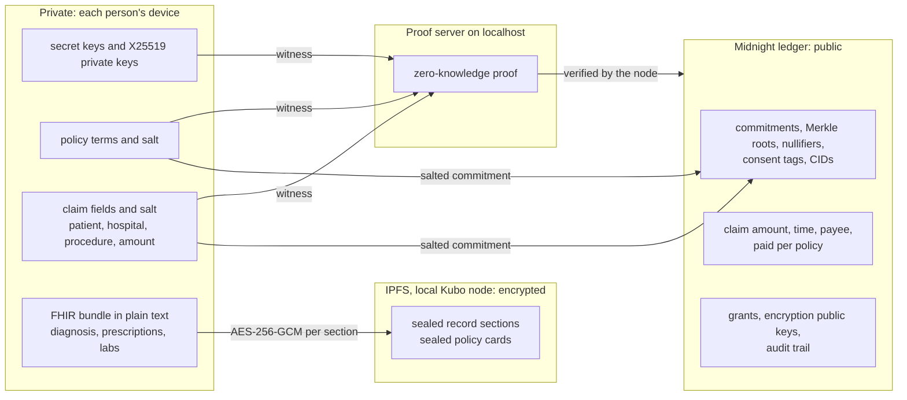

# zkClaim threat model

What zkClaim protects, from whom, how, and what it does not protect. It covers the contract ([`contract/src/zkclaim.compact`](../contract/src/zkclaim.compact)), the records library ([`records/`](../records/)), the app ([`ui/`](../ui/)) and the CLI demos ([`cli/`](../cli/)), running on a local Midnight devnet. The parts and flows are in [architecture.md](architecture.md).

## Assets

| Asset | What must hold |
|---|---|
| Medical content: diagnosis, procedures, prescriptions, labs | Only the patient, the treating hospital and people the patient (or an emergency) lets in can read it. |
| Policy terms: limit, expiry, covered procedures | Hidden from the public. The insurer wrote them; the patient and their hospital hold them. |
| The link between a person and their claims or records | A chain observer cannot make it. |
| The payout pool | Pays only valid claims, each once. |
| Claim validity | Approved hospital, issued and active policy, covered procedure, within the limit, patient consent. |
| The audit trail | Every grant, revoke, view and break-glass is recorded. No circuit edits or deletes an entry. |
| Keys | zkClaim secret keys, X25519 private keys, per-section AES keys, the emergency private key. |

## Actors and adversaries

| Actor | Wants to | Can | Cannot |
|---|---|---|---|
| Curious insurer | Read the diagnosis; deny or stall a valid claim; take back pool funds | See all public state; remove hospitals; stop topping up the pool; choose the emergency key at deploy; approve responders | Read diagnosis, procedure or prescriptions from the chain; reject a claim whose proof verifies; withdraw from the pool (no circuit lets it); swap the emergency key after deploy |
| Malicious hospital | Get paid for claims that break the policy; bill twice; inflate amounts | Write any record it likes before anchoring it | Claim without an issued policy, an active date, a covered procedure, the patient's consent, an amount equal to the record, room under the limit; claim the same record twice; use another hospital's record |
| Outsider replaying claims | Get a settled claim paid again, or redirect a payout | Copy any transaction it sees | Pass the nullifier check; change `payTo` without breaking the proof |
| Curious doctor, lab or pharmacy | Read more than its role; read after access ends; read without a trace | Decrypt the sections it was granted; keep what it has decrypted | Open other sections; pass `logView` without an unexpired grant; extend its own grant |
| Chain observer | Link people to claims and records; guess conditions | Read every public value; fetch any ciphertext by its CID from a node that stores it | Read ciphertext; link a claim to a record or a patient from the values alone; learn the patient's id from grants or revokes |
| Emergency responder | Read records without a real emergency | Break the glass if the insurer approved it; open the clinical, lab and medication sections of any record with the emergency key its app holds (L3) | Keep emergency access past an hour without a new break-glass entry; break the glass without a public audit entry |

## Privacy diagram: on-chain vs off-chain

Everything on the left stays on the device. Witnesses go only to the proof server on the same machine, which returns a proof. The chain gets the proof and the public values on the right. IPFS gets only ciphertext.

## What each party sees

| Data | Insurer | Hospital | Patient | Doctor, lab, pharmacy | Chain observer |
|---|---|---|---|---|---|
| Diagnosis, prescriptions, labs | no | yes, it wrote them | yes | its role's sections only | no |
| Procedure code | no | yes | yes | if its sections include it | no |
| Policy terms | yes, it wrote them | yes, the patient shows the card | yes | no | no |
| Which approved hospital claimed | only through the payee address | yes | yes | – | only through the payee address |
| Claim amount and time | yes | yes | yes | – | yes |
| That a policy has claims, and its running total | yes, and it knows whose policy it is | – | yes | – | yes, but not whose policy |
| Who holds access to a record, and every view | yes | yes | yes | its own grants | yes, but not whose record |

## STRIDE analysis

| ID | Threat | Mitigation | Code | Residual |
|---|---|---|---|---|
| S1 | A stranger acts as the insurer | The insurer's `admin` circuit needs the secret key behind `insurer` | `admin`, `assertInsurer` | Theft of the insurer's key |
| S2 | An unapproved or removed hospital anchors or claims | Merkle path from the caller's own id to a root in `hospitals`. A borrowed path fails. Removal forgets old roots. | `approvedHospitalPk`, `admin` action 2 | – |
| S3 | Someone consents, withdraws consent, grants or revokes for a patient | The circuits compare the policy holder and the record's patient with the caller's id, privately | `consentToClaim`, `ownedRecord` | – |
| S4 | Someone views or breaks the glass as another person | The actor id comes from the caller's secret key; break-glass needs `responders` membership | `logView` | – |
| T1 | The hospital changes the amount or the procedure at claim time | The claim must match the anchored record commitment the patient consented to | `submitClaim` steps 4–6 | The procedure code itself is the hospital's word (L5) |
| T2 | The hospital uses made-up terms (higher limit, more procedures) | The policy commitment must be in `policies`, which only the insurer writes | `submitClaim` step 2 | – |
| T3 | The claim date is moved to dodge expiry | `block time <= asOf < block time + 15 minutes`, and `expiresAt > asOf` | `submitClaim` step 3, `currentTime` | A 15-minute window |
| T4 | Someone edits a sealed record on IPFS | AES-GCM decryption fails on any change, and each part's name is bound in as associated data; the CID is a hash of the content; the record commitment includes the bundle hash | `records/`, `TreatmentRecord.contentHash` | – |
| T5 | Someone swaps the payee on a submitted claim | `payTo` is part of the proven transcript | `submitClaim` | – |
| T6 | The hospital settles a bill after the patient withdrew permission | Withdrawal removes the consent tag, and `submitClaim` checks the tag at settlement. The node rejects a claim proved against state that has since changed, so ledger order decides. A paid claim cannot be withdrawn (`Claim already settled`). The permission has no expiry. | `consentToClaim(true)`, `submitClaim` step 6 | A claim that lands first is final; a dispute over it is settled off-chain |
| R1 | The insurer or hospital disputes a payment | `{policy, amount, at}` is stored under the nullifier; the NIGHT transfer is on-chain | `claims` | – |
| R2 | A grantee denies reading a record | The app writes `logView` on-chain before it decrypts | `logView`, `ui/` | Enforced by the app (L2) |
| R3 | A responder denies emergency access | An emergency view writes a `breakGlass` entry with the reason hash, then the `viewed` entry, in the same transaction | `logView` | The emergency key holder can skip it (L3) |
| R4 | A patient denies consenting | Only the patient's secret key can produce or remove the consent tag, and every grant and withdrawal is a transaction on-chain | `consentToClaim` | – |
| I1 | The insurer reads diagnosis, procedure or prescriptions | Never on-chain: the procedure code is a witness and the FHIR content is encrypted. The privacy test scans all public state. | `zkclaim.test.ts`, `privacy` | – |
| I2 | A chain observer links a claim to a patient or record | Salted commitments; the consent tag and nullifier use the private record salt; grants and revokes prove ownership without the patient's id | `consentTag`, `claimNullifier`, `ownedRecord` | Payee (L6), timing (L9) |
| I3 | Anyone with a CID reads a record | Only ciphertext on IPFS; section keys wrapped to named slots, not to public keys anyone can see. The demo's Kubo node runs `--offline`, so nothing is announced to the public IPFS network. | `records/`, `docker-compose.yml` | Long-term storage (L12) |
| I4 | A grantee reads more than its role | One key per section; a grant carries only that role's keys; claim fields are hidden from grantees | `records/` (`ROLE_SECTIONS`, `grantKeyFor`) | – |
| I5 | Private inputs leave the device while proving | The proof server runs on localhost; 1AM is set to the local proof server | `docker-compose.yml`, [`e2e/README.md`](../e2e/README.md) | A remote prover would see them (L13) |
| I6 | Access metadata hints at a condition | – | – | L10 |
| D1 | The insurer refuses or stalls a valid claim | No approve or reject step: a verified proof is paid in the same transaction | `submitClaim` | The pool can run dry (L11) |
| D2 | The insurer removes a hospital to block its claims | Removing a licence is the insurer's call; it is public on-chain | `admin` action 2 | Other hospitals' unsent proofs must be rebuilt after any removal |
| D3 | A flood of replayed claims | Rejected by the nullifier check before any payout; each try costs the sender fees | `submitClaim` step 7 | – |
| D4 | The IPFS node is down | Local Kubo node for the demo | – | Availability is out of scope |
| E1 | A grantee extends its own access | Only the record owner writes grants; a break-glass grant lasts one hour, and renewing it writes a new break-glass entry | `setAccess`, `logView` | – |
| E2 | A responder approves itself | Approving responders is an insurer-only `admin` action | `admin` actions 4–5 | – |
| E3 | The insurer gains record access through emergency access | – | constructor (`emergencyPk`), `admin` actions 4–5 | L4 |

## Replays and double billing

The nullifier is `hash("zkclaim:nullifier:v1", record commitment, record salt)`. It depends only on the record, so one record can be paid once, under any policy, by anyone. A second submission fails with `Claim already settled` ("a replay of a settled claim"; `npm run demo` replays its claim and expects that rejection).

A hospital could anchor the same treatment twice with different salts. That gives two commitments and two nullifiers, but each claim also needs its own consent from the patient. The patient's consent screen is the check. Collusion between the two is L5.

## Residual risks

These are the limits of this prototype. The STRIDE table refers to them as L1 to L17.

- **L1. A grantee who has decrypted a record keeps that copy.** Revoking re-encrypts the record, so old keys open nothing new. Nothing can make someone forget what they saw.
- **L2. "Log before decrypt" is enforced by the app, not by cryptography.** The same holds for grant expiry: after expiry `logView` fails and the app stops, but the wrapped keys still open the current copy until the patient revokes. A modified app could read without logging.
- **L3. Break-glass relies on the emergency key holder's app honouring the log.** Every record is sealed to the emergency key, so its holder can open the clinical, lab and medication sections of any record with or without logging an emergency view.
- **L4. The insurer chooses the emergency key and the responders.** The insurer passes the emergency public key to the constructor when it deploys, and approving responders is an insurer-only `admin` action. A dishonest insurer could deploy with a key it holds and read the clinical, lab and medication sections of every record without a log entry. The key is public from deployment and no circuit can change it, so hospital apps can check it before sealing a record. In the app's demo mode every role shares one page, which generates the key pair at deploy. A real deployment would hand the key to an independent emergency authority.
- **L5. A hospital and a patient who collude can fabricate a claim.** The proof shows the claim matches a record that an approved hospital anchored and the patient consented to. It cannot show the treatment happened. The bundle hash in the record lets an auditor who gets the keys compare the claim with the FHIR content later.
- **L6. The payout recipient is public.** The proof hides which approved hospital claimed, but the payee address usually names it. Shielded payout is a stretch goal and is not built.
- **L7. NIGHT amounts and settlement times are public.** A distinctive amount can hint at the procedure.
- **L8. The insurer learns that a policy has claims.** The policy commitment appears in each settlement and in `spent`, and the insurer knows whose policy it is. It learns "this customer was paid this much on this date", not what for.
- **L9. Timing can link steps.** Anchor, consent and claim close together in time may let an observer tie a claim to a record commitment and its CID.
- **L10. Access metadata is public.** The grantee's id, role and expiry, and every view, are on-chain. A grant to a specialist, such as an oncology lab, hints at the condition.
- **L11. The pool must hold enough NIGHT.** A claim fails while the pool is short. The insurer cannot withdraw from the pool, but it can stop topping it up.
- **L12. IPFS copies are long-lived.** If X25519 or a recipient's private key is broken later, old copies can be decrypted.
- **L13. A remote proof server sees the private inputs.** The setup uses the local one; a wallet pointed elsewhere would leak witnesses to that server.
- **L14. `registerEncKey` writes the caller's id next to its key.** Anyone who registers is visibly a zkClaim user.
- **L15. Key storage is demo-grade.** zkClaim identity keys sit in browser `localStorage`; the CLI's private state store uses a fixed demo password. Not for real patient data.
- **L16. Transaction metadata is not analysed.** Fees, timing and network origin of a transaction may reveal who sent it. We have not studied this.
- **L17. One local node.** The devnet makes no claim about decentralisation, liveness or finality.

## Assumptions

- Midnight's proofs are sound and zero-knowledge, and the node verifies every contract call's proof.
- The proof server and the app run on the user's own machine and are not modified.
- Devices holding secret keys are not compromised.
- AES-256-GCM and X25519 (WebCrypto, used by `records/`) are secure, and keys come from a secure random source.
- Fictional people and companies only; no real health data was used.
